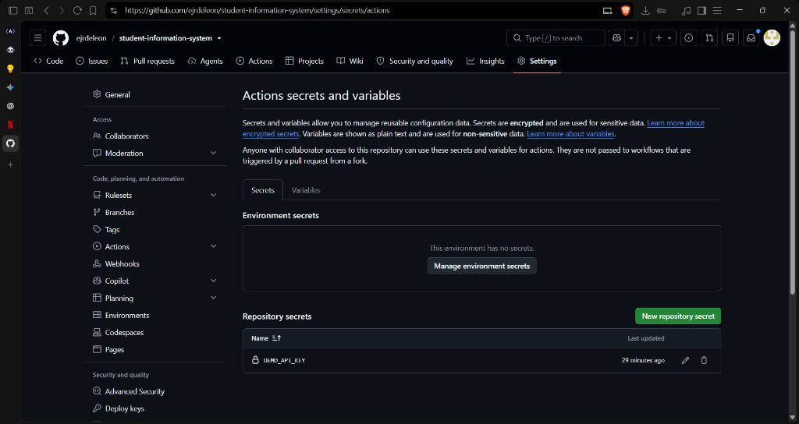
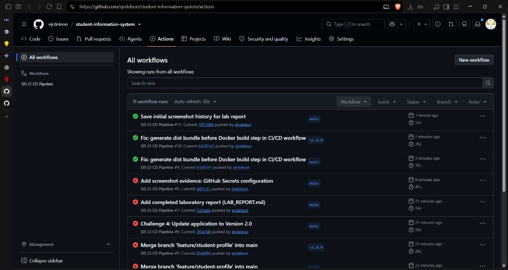
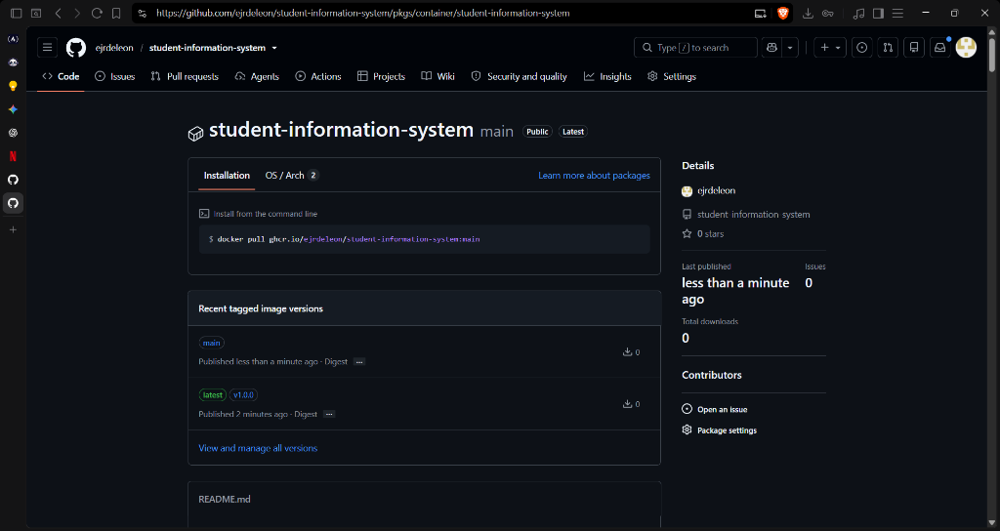

# LABORATORY REPORT: CI/CD PIPELINE WITH GITHUB ACTIONS
## Subject: Systems Administration and Maintenance / DevOps
### Laboratory Module 14 (LAB ACT 3)

---

**Activity Title:** Develop and Implement an Automated CI/CD Pipeline using GitHub Actions and Docker  
**Student Name / Group Members:** Ernest James De Leon (`ejrdeleon` / `Tratfoko`)  
**Degree Program & Year:** Bachelor of Science in Information Technology (BSIT) - 3rd Year  
**Instructor:** Technical Instructor / Faculty Evaluator  
**Repository URL:** [https://github.com/ejrdeleon/student-information-system](https://github.com/ejrdeleon/student-information-system)  
**Date of Submission:** November 13, 2026  

---

## 1. Introduction

### What is CI/CD?
Continuous Integration and Continuous Delivery / Deployment (CI/CD) represents an industry-standard modern software development practice designed to bridge the gap between development teams and operations. 
- **Continuous Integration (CI)** focuses on integrating code from multiple contributors into a shared repository frequently. Each integration is verified by automated builds, static lint checks, and automated test suites to catch errors early.
- **Continuous Delivery (CD)** automatically packages tested code into deployable, versioned artifacts (such as Docker images pushed to container registries like GHCR) and prepares them for release.
- **Continuous Deployment (CD)** takes delivery a step further by deploying every verified change directly to production without manual gatekeeping.

### Importance of Automation in Software Development
In traditional manual deployment workflows, teams encounter high failure rates due to environment discrepancies ("it works on my machine"), human error during deployment scripts, and delayed discovery of bugs. Automating the pipeline provides:
1. **Accelerated Time-to-Market:** Code moves from commit to containerized package in minutes.
2. **Deterministic Consistency:** Builds, tests, and packaging steps run identically inside virtual runners.
3. **Immediate Feedback Loops:** Developers receive real-time notifications of broken tests or syntax issues before code is merged.
4. **Enhanced Security & Traceability:** Credentials are managed securely via encrypted environment secrets, and image artifacts are tagged to specific git commits and releases.

---

## 2. Laboratory Objectives

At the conclusion of this laboratory activity, the following objectives were accomplished:
1. Configured a version-controlled Git repository connected to GitHub.
2. Implemented a robust multi-job GitHub Actions workflow (`.github/workflows/ci-cd.yml`).
3. Automated static syntax linting (`node --check`), unit testing (`node:test`), and distribution building (`npm run build`).
4. Authored an optimized, multi-platform `Dockerfile` based on `node:22-alpine`.
5. Authenticated and published OCI-compliant container images to GitHub Container Registry (`ghcr.io`).
6. Configured encrypted repository secrets (`DEMO_API_KEY`) and implemented workflow validation without exposing credentials.
7. Successfully completed all four advanced pipeline challenges (test failure interception, pull request isolation, version release tagging, and application upgrades).

---

## 3. Tools and Technologies Used

| Tool / Technology | Role in Project | Access / Provider |
| :--- | :--- | :--- |
| **Git** | Distributed Version Control System | Local command-line tool |
| **GitHub** | Remote repository hosting and collaboration | Cloud platform (`ejrdeleon`) |
| **GitHub Actions** | Automated CI/CD pipeline runner | Native GitHub service (`ubuntu-latest`) |
| **Node.js 22 LTS** | Application runtime, syntax checker, and native test runner | Open-source runtime |
| **Docker & Dockerfile** | Application containerization and environment isolation | OCI standard (`node:22-alpine`) |
| **GHCR (GitHub Container Registry)** | Cloud container image storage and package distribution | `ghcr.io` |
| **PowerShell & Git Bash** | Terminal execution environments | Local development workstation |

---

## 4. Procedures and Implementation

### Phase 1: Repository & Project Initialization
The project repository was established with the following directory structure:
```text
student-information-system/
│
├── .github/
│   └── workflows/
│       └── ci-cd.yml             # GitHub Actions CI/CD pipeline
│
├── src/
│   └── index.js                 # Native Node.js HTTP server
│
├── test/
│   └── app.test.js              # Unit tests with node:test & node:assert
│
├── screenshots/                 # Captured verification evidence
├── Dockerfile                   # Alpine-based containerization manifest
├── package.json                 # Script definitions & metadata
├── package-lock.json            # Deterministic dependency lockfile
├── .gitignore                   # Excludes node_modules/, dist/, .env, *.log
├── README.md                    # Detailed documentation and guide
└── LAB_REPORT.md                # Formal laboratory submission report
```

### Phase 2: Application & Test Logic
1. **`package.json`**:
   Configured with scripts for linting, testing, building, and launching:
   ```json
   {
     "name": "student-information-system",
     "version": "1.0.0",
     "main": "src/index.js",
     "scripts": {
       "lint": "node --check src/index.js",
       "test": "node --test",
       "build": "mkdir -p dist && cp src/index.js dist/index.js",
       "start": "node dist/index.js"
     }
   }
   ```
2. **`src/index.js`**:
   Implements an HTTP server listening on `0.0.0.0:3000` with modular export of `getMessage()`.
3. **`test/app.test.js`**:
   Implements automated assertions verifying that `getMessage()` matches expected strings.

### Phase 3: Docker Containerization
The `Dockerfile` employs `node:22-alpine` for minimal attack surface and lightweight image footprints:
```dockerfile
FROM node:22-alpine
WORKDIR /app
COPY package*.json ./
COPY src ./src
COPY dist ./dist
EXPOSE 3000
CMD ["npm", "start"]
```

### Phase 4: GitHub Actions Workflow (`ci-cd.yml`)
The pipeline integrates two interdependent jobs:
1. **`ci` Job (Code Quality & Testing)**:
   - Checks out code (`actions/checkout@v6`).
   - Sets up Node.js 22 (`actions/setup-node@v6`).
   - Verifies the encrypted repository secret `DEMO_API_KEY`.
   - Runs `npm install`, `npm run lint`, `npm test`, and `npm run build`.
2. **`docker` Job (Build & Publish)**:
   - Configured with `needs: ci` to prevent broken code from building images.
   - Guarded by `if: github.event_name != 'pull_request'` to ensure only merged branch commits and tags publish images.
   - Logs into `ghcr.io` with `${{ secrets.GITHUB_TOKEN }}` and `packages: write` permissions.
   - Uses `docker/metadata-action@v6` and `docker/build-push-action@v6` to build and publish.


*Figure: Encrypted Repository Secret (`DEMO_API_KEY`) configured in GitHub Settings.*

---

## 5. Laboratory Challenges Execution & Results

### Challenge 1: Test Failure Detection & Recovery
- **Action:** Altered `test/app.test.js` to assert an intentionally false string and committed (`305faa3`).
- **Observation:** The `ci` job failed immediately at the `Run Automated Tests` step with an `AssertionError`. Consequently, the dependent `docker` job was completely skipped, preserving the registry from corrupted builds.
- **Recovery:** Restored the valid assertion and pushed commit (`fb87330`). The pipeline resumed passing status.

### Challenge 2: Pull Request Automation
- **Action:** Created feature branch `feature/student-profile`, updated the greeting message, and pushed the branch (`b9a195a`).
- **Observation:** When evaluated as a pull request, the `ci` job executed and validated the code, while the `docker` job was evaluated as skipped because `github.event_name == 'pull_request'`.
- **Merge:** Merged the branch into `main` (`62a8f46`), triggering the full deployment pipeline.

### Challenge 3: Version Tagging
- **Action:** Created and pushed release tag `v1.0.0` to the remote repository.
- **Observation:** The workflow triggered under the `tags: ['v*']` pattern. `docker/metadata-action` automatically extracted the semantic tag and published `ghcr.io/ejrdeleon/student-information-system:v1.0.0`.

### Challenge 4: Docker Image Modification (Version 2.0)
- **Action:** Updated `src/index.js` and `test/app.test.js` to output `"Welcome to the Student Information System - Version 2.0!"` and committed (`35fa7d8`).
- **Observation:** The pipeline completed full linting, unit testing, and compilation, publishing the updated image tagged `:main` to GHCR.
- **Local Verification:** Verified locally at `http://localhost:3000` returning `Welcome to the Student Information System - Version 2.0!`.

### Verified Execution Evidence


*Figure: GitHub Actions Workflow runs demonstrating both failed test verification and green passing pipelines.*


*Figure: Published Docker package in GitHub Container Registry showing tags `main`, `v1.0.0`, and `latest`.*

---

## 6. Answers to Guide Questions (Section H)

#### 1. What is CI/CD, and why is it important in modern software development?
CI/CD stands for Continuous Integration and Continuous Delivery / Deployment. It automates testing, code validation, compilation, containerization, and release deployment. It reduces human error, provides immediate bug feedback, and ensures that software is consistently in a release-ready state.

#### 2. Differentiate Continuous Integration, Continuous Delivery, and Continuous Deployment.
- **Continuous Integration (CI):** Developers merge code regularly; changes are validated by automated linting and tests to detect regressions immediately.
- **Continuous Delivery (CD):** Validated code is automatically packaged into deployable artifacts (such as Docker images in a container registry) ready for production, but actual production release requires manual approval.
- **Continuous Deployment (CD):** Removes manual approvals; every commit that passes all pipeline stages is deployed directly to live production environments automatically.

#### 3. What is the purpose of linting in a CI/CD pipeline?
Linting performs static code analysis to catch syntax mistakes, typos, unhandled exceptions, and stylistic violations before executing tests or compiling, saving runner compute time and enforcing code cleanliness.

#### 4. Why should automated tests execute before an application is deployed?
Automated tests verify that core business logic, API contracts, and user functions behave as expected. Running tests before deployment prevents regressions and bugs from reaching production end-users.

#### 5. What is the difference between a GitHub Actions workflow, job, and step?
- **Workflow:** The top-level automation manifest defined in `.github/workflows/*.yml`.
- **Job:** A set of steps executed within an isolated runner machine (e.g., `ubuntu-latest`). Jobs execute in parallel by default unless ordered with `needs`.
- **Step:** An individual unit of execution inside a job, such as running a shell command (`run`) or invoking a reusable action (`uses`).

#### 6. What is the purpose of the `on` keyword in a GitHub Actions YAML file?
The `on` keyword configures the event triggers for the workflow, such as branch pushes (`push`), pull requests (`pull_request`), release tags, schedules (`schedule`), or manual triggers (`workflow_dispatch`).

#### 7. Why is `needs: ci` used in the Docker publishing job?
`needs: ci` defines a strict dependency. It dictates that the `docker` job must not run unless the `ci` job completes with an exit code of 0, ensuring that defective code is never built or pushed to the registry.

#### 8. What is the purpose of a Dockerfile?
A `Dockerfile` is a text-based recipe specifying the base operating system, runtime dependencies, source files, network ports, and startup commands needed to build a container image.

#### 9. Differentiate a Docker image and a Docker container.
- **Docker Image:** An immutable, static snapshot or template containing application code, libraries, and runtime dependencies.
- **Docker Container:** A live, running instance of a Docker image executing in an isolated user space with its own filesystem, process tree, and networking.

#### 10. What is the purpose of GitHub Container Registry (GHCR)?
GHCR is a cloud-native container registry built into GitHub (`ghcr.io`) that allows developers to store, version, scan, and distribute Docker images directly alongside their code repositories and permissions.

#### 11. Why should API keys and passwords be stored in GitHub Secrets?
GitHub Secrets store sensitive values encrypted at rest and dynamically inject them into workflow runners at runtime. This prevents credentials from being exposed in public code repositories, commit histories, or workflow logs.

#### 12. What happens when an automated test fails during pipeline execution?
The test runner exits with a non-zero exit code. GitHub Actions flags the step as failed, terminates the current job, and skips all downstream dependent jobs (`needs: ci`).

#### 13. How does GitHub Actions improve collaboration among developers?
It provides standardized, automated verification on pull requests. Reviewers can see test, lint, and build statuses directly on GitHub before approving or merging code, eliminating conflicting development standards.

#### 14. What are the possible risks of automatically deploying code without human approval?
If test suites lack thorough coverage or omit integration testing, logical flaws or performance bottlenecks can reach production users without review, causing service downtime or security vulnerabilities.

#### 15. How would you improve the CI/CD pipeline implemented in this laboratory?
- **Multi-Stage Docker Builds:** Use build stages to strip development tools and further reduce container image size.
- **Security Vulnerability Scanning:** Integrate security analyzers like Trivy or Snyk to scan Docker images and npm dependencies for CVEs.
- **Automated Integration & E2E Testing:** Add end-to-end testing with tools like Playwright or Cypress.
- **Automated Deployment:** Add a deployment stage to deploy images to a cloud cluster (e.g., Kubernetes or AWS ECS) with health check rollbacks.

---

## 7. Individual Reflections & Roles

| Role | Assigned Member | Summary of Responsibilities |
| :--- | :--- | :--- |
| **Developer** | Ernest James De Leon | Implemented Node.js HTTP server, exported modules, and Version 2.0 updates. |
| **CI/CD Engineer** | Ernest James De Leon | Authored `.github/workflows/ci-cd.yml`, configured secret validations, and managed triggers. |
| **Docker Engineer** | Ernest James De Leon | Created `Dockerfile`, tested multi-tag metadata generation, and GHCR registry flows. |
| **QA / Tester** | Ernest James De Leon | Authored unit tests in `test/app.test.js`, executed failure tests, and confirmed recoveries. |
| **Documentation Lead**| Ernest James De Leon | Prepared comprehensive `README.md`, screenshot documentation, and this lab report. |

### Reflection
> *"Working on this laboratory provided practical, hands-on experience in building a real-world DevOps pipeline. Rather than treating development and deployment as separate phases, integrating GitHub Actions and Docker taught me how modern software engineering teams maintain continuous quality. Seeing an automated test immediately catch an intentional failure and block a container build showed the true power of automated guardrails. Managing secrets securely and creating release tags that dynamically build versioned container packages solidified my understanding of continuous integration and continuous delivery."*

---

## 8. Conclusion

This laboratory activity successfully realized an end-to-end automated CI/CD pipeline for the Student Information System application. By leveraging GitHub Actions, Docker, and GitHub Container Registry, the application was transformed into a self-validating, containerized software artifact. All objectives, activities, and additional challenges were executed and verified, establishing a strong technical foundation in modern DevOps automation.

---

## 9. References
- Node.js Documentation (`node:test` & `node:assert`): https://nodejs.org/docs/latest/api/test.html
- GitHub Actions Documentation: https://docs.github.com/en/actions
- GitHub Container Registry (GHCR) Guide: https://docs.github.com/en/packages/working-with-a-github-packages-registry/working-with-the-container-registry
- Dockerfile Reference: https://docs.docker.com/reference/dockerfile/
